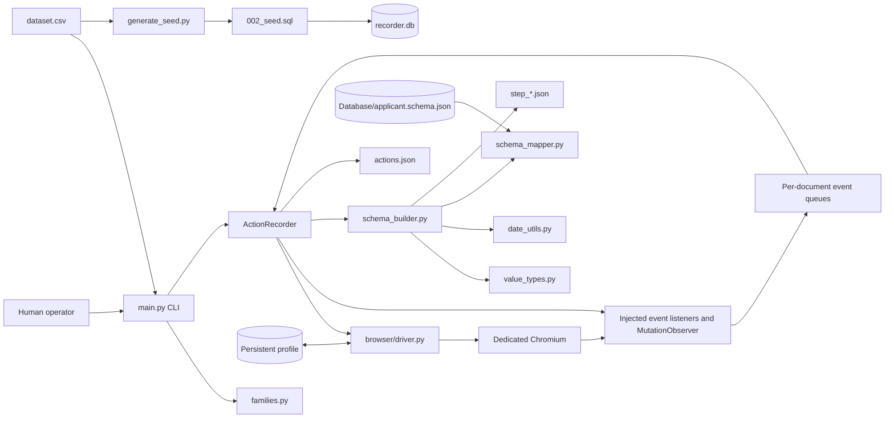
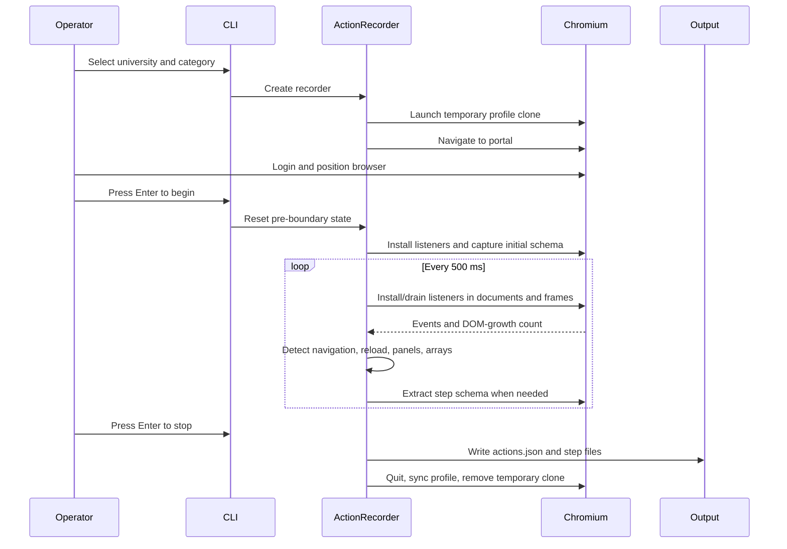
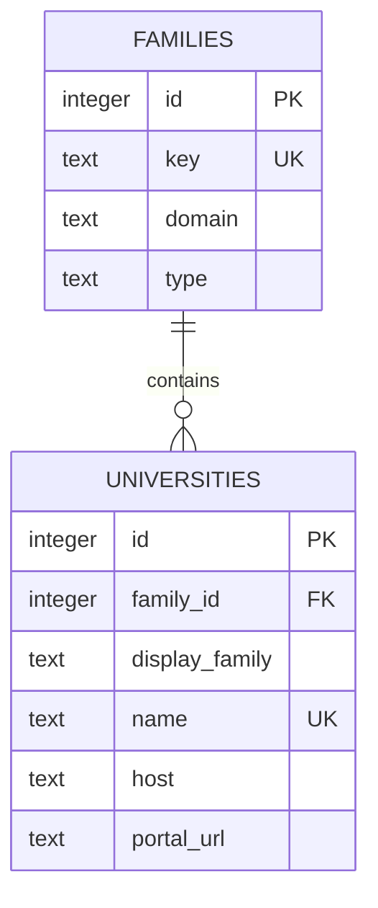

# Caution! This file is for reference only
# Portal Recorder - Complete Technical Report

> Historical baseline (2026-08-10): this report predates the versioned
> recorder-contract implementation. For current behavior use
> [readme.md](readme.md), [Phase 1 Recorder Contract](doc/PHASE1_RECORDER_CONTRACT.md),
> and [Portal Compatibility Audit](doc/PORTAL_COMPATIBILITY.md). In particular,
> meta-data.json is now consumed for canonical candidates, publication is
> atomic, and the test inventory below is no longer current.

**Report date:** 2026-08-10  
**Assessment type:** Current-state architecture, implementation, data, security, quality, and operations audit  
**Project location:** `D:\project\Autofill Project\Recorder`  
**Audited runtime:** Windows, Python 3.14.6  
**Source revision:** Unavailable because this workspace contains no Git repository metadata

## 1. Executive summary

Portal Recorder is a Windows-oriented, human-operated Selenium application that records interactions with university admission portals. It launches a dedicated Chromium installation, lets an operator position the browser at a chosen workflow boundary, captures interaction events and page schemas, and writes JSON artifacts for later analysis or model training.

The current repository is a **recorder and schema-discovery prototype**, not a working autofill system. It does not ingest applicant profiles, replay recorded actions, populate portal fields, maintain a mapping knowledge base, or submit applications. The current [README](readme.md) states this boundary correctly, although older Word specifications still describe an `ingest` command and profile-selection workflow that do not exist.

The implementation has several strong foundations:

- explicit operator-controlled start and stop boundaries;
- privacy-first value redaction by default;
- a dedicated Chromium profile rather than the operator's everyday browser profile;
- recursive iframe extraction and limited open-shadow-root support;
- schema enrichment for labels, constraints, dates, field types, mappings, and validation errors;
- atomic writes for each JSON file;
- 86 passing unit tests;
- a consistent 138-university CSV and SQLite catalog.

However, it should be treated as **pre-production** until the following high-impact issues are corrected:

1. Field signatures include the snapshot step name, which invalidates cross-step visibility comparisons and produces false hidden/revealed dependencies.
2. Repeating education, work, and referee rows cannot be mapped reliably because array indexing is assigned to an entire page snapshot rather than to each row.
3. Opt-in value capture can retain custom OTP/payment controls, full URL query strings, fragments, and DOM `data-*` values despite documentation that implies a narrower scope.
4. The persistent browser profile contains authentication cookies and login databases, has no retention command or concurrency lock, and is currently about 1.16 GB.
5. Seventeen configured portals begin with unencrypted HTTP URLs.
6. Database initialization without `--reset` is not idempotent, contrary to the README.
7. The applicant metadata template is incomplete relative to the Master Data Set PDF, is not a formal JSON Schema, and has no runtime ingestion consumer.
8. Browser events are timestamped when Python drains them rather than when they occur, and fast navigation can destroy undrained page-local events.

### 1.1 Verified project baseline

| Measure | Verified result |
|---|---:|
| Application source files | 11 Python files |
| Application source size | 2,718 lines |
| Test modules | 9 |
| Test code size | 1,112 lines |
| Unit tests | 86 passed, 0 failed |
| University records | 138 |
| Portal families | 62 |
| Shared-platform universities | 79 |
| Custom-domain universities | 59 |
| Saved recording sessions | 7 |
| Saved JSON artifacts | 36 valid files |
| Saved step snapshots | 29 |
| Saved actions | 137 |
| Captured interactive elements | 458 |
| Existing non-null applicant mappings | 0 |
| Plain-HTTP portal URLs | 17 |
| Persistent Chromium footprint | Approximately 1.16 GB |

## 2. Purpose and scope

### 2.1 Current purpose

The current system records how a human uses an admission portal so later components can learn:

- what pages and sections exist;
- which interactive controls are present;
- how labels, constraints, and controls relate;
- which actions cause navigation, validation, or dynamic field changes;
- which portal fields may correspond to a target applicant-data path;
- how shared admission-system families behave across universities.

### 2.2 Implemented scope

The repository currently implements:

- CSV-based university selection;
- five session categories: `AUTH`, `Registration`, `Application`, `Data Entry`, and `Checkup`;
- domain/family classification;
- dedicated Chromium and ChromeDriver lifecycle management;
- manual positioning followed by explicit recording start;
- input, change, click, submit, navigation, reload, and validation-error events;
- dynamic DOM and panel-change snapshots;
- iframe and limited open-shadow-root form extraction;
- field metadata enrichment;
- conservative regex-based applicant-path suggestions;
- JSON session export;
- SQLite catalog generation.

### 2.3 Explicitly unimplemented scope

The repository does **not** implement:

- applicant profile ingestion;
- an `ingest` CLI command;
- field-value resolution from an applicant profile;
- autofill execution or replay;
- automated navigation through an application;
- CAPTCHA or two-factor authentication handling;
- application submission;
- a backend service, API, web interface, or GUI;
- model training or inference;
- a persisted mapping knowledge base;
- screenshots, HAR files, or browser network traces;
- deployment packaging or an installer.

Any future autofill engine should remain a separate component that consumes a versioned, validated recorder artifact contract.

## 3. Technology stack and platform assumptions

| Area | Technology | Notes |
|---|---|---|
| Language | Python | README states 3.9+, but the installed Selenium 4.46.0 requires Python 3.10+ |
| Browser automation | Selenium 4 | Drives Chromium through ChromeDriver |
| Driver management | `webdriver-manager` | Downloads or reuses ChromeDriver at runtime |
| Browser | Dedicated Chromium | Portable build currently resides under `chromium_profile/` |
| Browser instrumentation | Injected JavaScript | Event listeners, validation observation, and DOM mutation tracking |
| Date parsing | `python-dateutil` | Normalizes typed dates and flags ambiguous numeric dates |
| Catalog persistence | SQLite | Standard-library `sqlite3`; reporting/catalog use only |
| Primary input | CSV | `dataset.csv` contains display families, university names, and portal links |
| Primary output | JSON | One action log plus one or more step-schema files per session |
| Operating system | Windows | PowerShell is used to read Chromium file versions |

The declared dependencies in [requirements.txt](requirements.txt) are broad ranges:

```text
selenium>=4.20,<5
webdriver-manager>=4,<5
python-dateutil>=2.9,<3
```

There is no lockfile, hash-pinned constraints file, `pyproject.toml`, virtual-environment bootstrap script, or supported Python-version matrix. The code also imports `packaging` directly even though it is available only transitively in the current environment.

## 4. Repository structure

| Path | Role |
|---|---|
| [main.py](main.py) | CLI parsing, CSV loading, university/category selection, command dispatch |
| [config.py](config.py) | Paths, categories, duration, browser settings, privacy switch |
| [families.py](families.py) | Registrable-domain reduction and admission-system family classification |
| [browser/driver.py](browser/driver.py) | Chromium discovery, driver management, profile cloning, startup, cleanup |
| [pipeline/recorder.py](pipeline/recorder.py) | Runtime orchestration, event collection, step capture, session persistence |
| [extractor/schema_builder.py](extractor/schema_builder.py) | DOM extraction, label/section discovery, frames, shadow roots, metadata assembly |
| [extractor/value_types.py](extractor/value_types.py) | Static and value-assisted field-type inference |
| [extractor/date_utils.py](extractor/date_utils.py) | Date normalization and ambiguity reporting |
| [extractor/schema_mapper.py](extractor/schema_mapper.py) | Regex-based field/document mapping to applicant paths |
| [dataset.csv](dataset.csv) | University and portal catalog source |
| [meta-data.json](meta-data.json) | Commented applicant template; not consumed at runtime |
| [Database/applicant.schema.json](Database/applicant.schema.json) | Comment-free runtime mapper target |
| [Database/001_schema.sql](Database/001_schema.sql) | SQLite family/university catalog schema |
| [Database/002_seed.sql](Database/002_seed.sql) | Generated catalog inserts |
| [Database/generate_seed.py](Database/generate_seed.py) | CSV-to-SQL seed generator |
| [Database/init_db.py](Database/init_db.py) | SQL application and optional database reset |
| `output/sessions/` | Recorded action logs and step snapshots |
| `chromium_profile/` | Chromium executable plus persistent authentication/profile state |
| `tests/` | Unit tests using `unittest` and mocks |
| `doc/` | Original overview, issue, and master-data requirements documents |

Generated/local material is present in the workspace, including bytecode caches, a database file, recorded sessions, and the large Chromium directory. `.gitignore` lists the major generated paths, but ignore effectiveness cannot be verified because no `.git` metadata exists.

## 5. System architecture



The SQLite branch is independent of recording. At record time the CLI reloads the CSV and classifies domains directly; it does not query `recorder.db`.

## 6. Entry points and CLI behavior

### 6.1 Commands

```powershell
# List all valid dataset entries
python main.py list

# Start an interactive recording
python main.py record

# Select a university by display number and configure the fallback duration
python main.py record 2 --category "Data Entry" --duration 900

# Regenerate seed SQL and rebuild the database
python main.py init-db --reset
```

The parser also accepts a global `--dataset` path. There is no `ingest` subcommand despite older documents describing one.

### 6.2 Dataset loading

`load_universities()` accepts either of these header pairs:

- `University`, `Portal`; or
- `University Name`, `Portal Link`.

It trims values, skips rows with a blank name or portal, and assigns an ID based on the filtered row order. It does not validate URL schemes, hostnames, uniqueness, or redirect behavior.

Current dataset checks found:

- 138 rows;
- 0 blank names;
- 0 blank URLs;
- 0 duplicate names;
- 0 duplicate URLs;
- 121 HTTPS URLs;
- 17 HTTP URLs;
- 0 URLs without a parsed hostname.

Row-position IDs are not durable identifiers: reordering or deleting a CSV row changes later IDs and can break cross-session correlations.

### 6.3 Category storage behavior

| Category | Storage grouping |
|---|---|
| `AUTH` | Admission-system family or custom domain |
| `Registration` | Admission-system family or custom domain |
| `Application` | University-specific |
| `Data Entry` | Admission-system family or custom domain |
| `Checkup` | Admission-system family or custom domain |

The family grouping is intended to reuse recordings across universities sharing `17gz.org`, `at0086.cn`, or `cucas.cn`. Application recordings stay university-specific because program and scholarship choices can differ even on a shared platform.

## 7. Runtime recording workflow



### 7.1 Positioning boundary

`ActionRecorder.start()` launches Chromium but does not install capture listeners. The operator can log in and navigate to the target category page. Only after the first terminal Enter does `begin_recording()` clear state, install listeners, and capture `initial_load`.

This behavior satisfies the central acceptance criteria in [doc/Issue.docx](doc/Issue.docx): browser startup and positioning are excluded, while a second Enter ends and saves the recording.

### 7.2 Browser-side event capture

Injected JavaScript records:

- `input` for inputs and textareas;
- `change` for inputs, selects, and textareas;
- qualifying button, link, handler, and button-role clicks;
- form submission;
- native and ARIA validation errors;
- visible error/live-region mutations.

Click intent is heuristically classified as:

- `ADD_ARRAY_ROW`;
- `NAVIGATE_NEXT`;
- `SUBMIT`;
- `SEARCH`;
- `NAVIGATE_LINK`;
- `CLICK`.

The next observed navigation, DOM growth, or panel capture marks the pending intent as confirmed. A later click or session end marks it unconfirmed.

### 7.3 Dynamic-page capture

A `MutationObserver` counts added controls and controls revealed through changes to `class`, `style`, `hidden`, or `aria-hidden`. The polling loop also recognizes portal-specific panel patterns and generic add-row clicks. When a qualifying change occurs, a new step schema is captured after a short settling delay.

### 7.4 Navigation and termination

The recorder detects:

- URL changes;
- same-URL document reloads through `performance.timeOrigin` changes;
- previously visited URLs, labeled as backward navigation;
- fields edited again after backward navigation.

Recording stops on:

- terminal Enter;
- duration timeout;
- Ctrl+C;
- browser connection error.

The session is labeled `completed` only when the last step's heuristic phase is `completed`; all other sessions are labeled `incomplete`.

## 8. Browser and profile management

### 8.1 Chromium discovery

The driver layer checks, in order:

1. `CHROMIUM_BINARY`;
2. `chrome.exe` inside `RECORDER_CHROMIUM_PROFILE_DIR`;
3. standard `Chromium\Application\chrome.exe` paths under Program Files and Local AppData.

It intentionally does not fall back to Google Chrome.

### 8.2 ChromeDriver resolution

The code reads Chromium's Windows file version with PowerShell, asks `webdriver-manager` for a matching driver, and limits the blocking wait to 30 seconds. When an exact continuous-build driver is unavailable, it queries Chrome-for-Testing versions for a same-major fallback. If setup fails, it reuses the newest cached driver.

Risks:

- the newest cached driver is not verified against Chromium's major version;
- a timed-out installer thread is daemonized but not cancelled;
- network access is required for a cold driver cache;
- startup behavior is not reproducible without a pinned browser/driver pair.

### 8.3 Profile lifecycle

Before launch, selected profile material is copied into a temporary `portal_recorder_*` directory. The copy includes:

- `Local State`;
- cookies;
- login data;
- preferences;
- Web Data;
- local and session storage;
- network state.

After normal shutdown, the temporary state is synced back and the temporary directory is removed.

Operational concerns:

- no process lock prevents concurrent sessions from racing or overwriting profile state;
- cleanup errors are printed but do not make session saving fail;
- crashes can leave credential-bearing temporary clones;
- no startup scavenger removes stale clones;
- no CLI command purges the persistent profile;
- documentation recommends deleting `chromium_profile/`, but that directory currently also contains the portable Chromium executable.

The executable and user-data profile should be separated before a purge command is added.

## 9. Schema extraction and enrichment

### 9.1 DOM coverage

The extractor collects:

- inputs, selects, textareas, buttons, and links;
- elements with `onclick` handlers;
- elements with button/link/menu-item roles;
- elements using `btn` or `button` classes;
- visible custom radio/checkbox backings;
- elements in iframes and frames up to depth five;
- elements in one level of open shadow root.

Closed shadow roots are inaccessible. Nested shadow roots beyond one hop are skipped. Document-level action listeners do not explicitly attach inside shadow roots, so schema discovery is stronger than event capture for some web components.

### 9.2 Captured element metadata

Each element can include:

| Group | Representative fields |
|---|---|
| Identity | tag, type, name, ID, class, XPath, field signature |
| Semantics | label, semantic label, label source, label distance, form section |
| State | required, disabled, readonly, visible, tab index |
| Constraints | lengths, pattern, min, max, multiple |
| Accessibility | ARIA label, required, described-by, role |
| Options | select options, radio/checkbox group options |
| Help and validation | help text, validation message |
| Geometry | bounding box |
| Frame context | frame depth and source |
| Type enrichment | inferred data type, validation pattern, observed value shape |
| Date enrichment | normalized value, precision, imputed-day and ambiguity flags |
| Applicant mapping | schema path, confidence, evidence, document type |

### 9.3 Semantic-label discovery

Labels are attempted in this order:

1. `label[for]`;
2. wrapping label;
3. immediately preceding label;
4. fieldset legend;
5. `aria-labelledby`;
6. nearest visible text within three ancestors and 200 pixels.

Section headings are derived from enclosing `section`, `fieldset`, headings, ARIA labels, and title-like classes.

### 9.4 Type inference

Static rules infer:

- email;
- phone;
- date;
- passport number;
- postal code;
- URL;
- GPA;
- otherwise text.

If ordinary values are enabled, a regex layer can refine email, phone, and one narrow passport pattern, then produce a generalized letter/digit shape.

Limitations include:

- no first-class boolean, checkbox, radio, select, numeric, currency, score, or file type;
- no semantic-label or section input to type inference;
- passport regex recognizes only one uppercase letter followed by eight digits;
- native patterns are copied but not compiled or tested;
- `aria-required` does not contribute to the required-field count.

### 9.5 Date normalization

Dates are parsed only when value capture is enabled and the field is already inferred as a date. Results retain day, month, or year precision. Numeric values such as `03/04/2024` are flagged as ambiguous when both leading components could be a month.

## 10. Session output contract

### 10.1 Directory layout

```text
output/sessions/<category>/<organization-key>/<university>_<session-id>/
```

`organization-key` is a portal family/custom domain for family-scoped categories and a university-derived key for `Application`.

### 10.2 `actions.json`

Top-level fields include:

- `format_version`;
- session/category/organization/university identifiers;
- start and end timestamps;
- `input_values_captured`;
- `completion_status`;
- `stop_reason`;
- action count and actions;
- visibility dependencies.

An action includes a Python-assigned timestamp, event type, target metadata, value, URL, current step, and optional frame, intent, validation, navigation, or re-edit annotations.

### 10.3 `step_*.json`

Each step contains:

- step name;
- redacted URL according to the privacy mode;
- page title;
- heuristic session phase;
- total/visible/hidden statistics;
- captured elements;
- optional repeating-array annotations.

Step files do not contain a format version, schema version, mapping-rules version, session ID, university, or category. Their provenance depends on the surrounding directory and action log.

### 10.4 Write guarantees

Each JSON file is written to a temporary sibling and atomically replaced. This prevents a partially written individual file from replacing a valid one.

The complete session is **not** atomically published: `actions.json` is written first and step files follow sequentially. A mid-save failure can leave a visible, incomplete session directory. A staging directory plus manifest and final directory rename would provide a stronger contract.

## 11. Current recorded-artifact assessment

The workspace contains seven sessions:

- six `AUTH` sessions;
- one `Registration` session;
- zero `Application`, `Data Entry`, or `Checkup` sessions.

All 36 JSON files parse successfully. Current aggregate metrics are:

| Metric | Count |
|---|---:|
| Actions | 137 |
| Input events | 86 |
| Change events | 15 |
| Clicks | 12 |
| Navigation events | 12 |
| Reload events | 7 |
| Submit events | 2 |
| Validation errors | 3 |
| Step snapshots | 29 |
| Unknown phases | 27 |
| Core-application-form phases | 2 |
| Captured elements | 458 |
| Input/select/textarea elements | 62 |
| Elements inside frames | 6 |
| Hidden elements retained | 14 |
| Required elements | 12 |
| Non-null schema paths | 0 |
| Non-null document mappings | 0 |

All seven sessions were stopped by user Enter and labeled incomplete. Every action log has `input_values_captured=false`; all 101 input/change values are `[REDACTED]`, and the schema snapshots contain no non-redacted primary field values.

Zero mappings are not conclusive evidence that mapping always fails because the corpus is almost entirely authentication flows. However, there is no saved realistic Data Entry corpus demonstrating end-to-end applicant mapping.

## 12. University family and SQLite catalog

### 12.1 Family classification

`families.py` uses a small custom registrable-domain function for known Chinese compound suffixes. Shared platform domains are hard-coded:

- `17gz.org` - 24 universities;
- `at0086.cn` - 52 universities;
- `cucas.cn` - 3 universities.

A manual alias maps `istudy.ntu.edu.cn` to `cucas.cn`. All other registrable domains are treated as custom.

The current catalog contains:

- 3 shared families serving 79 universities;
- 59 custom families serving 59 universities;
- 62 families total;
- 138 universities total.

The CSV also supplies six broader display families. They are stored on each
university as `display_family` and are intentionally separate from the 62
operational family keys: grouping unrelated `edu.cn` portals together for
display must not make their recorder artifacts interchangeable.

This approach is understandable for a curated dataset but is not a general public-suffix solution and has no provenance or verification date for vendor aliases.

### 12.2 Database model



The database passes `integrity_check`, has zero foreign-key violations, and matches the current CSV.

### 12.3 Initialization defect

`init_db.py` applies every SQL file on every run. The generated seed uses unconditional `INSERT` statements against unique family keys and university names. Applying the seed twice fails with:

```text
IntegrityError: UNIQUE constraint failed: families.key
```

This contradicts the README statement that `--reset` may be omitted to apply SQL in place. The recommended design is either:

- transactional upserts and deletion of obsolete catalog rows; or
- a mandatory rebuild into a temporary database, integrity validation, then atomic replacement.

The current `--reset` implementation deletes the existing database before rebuilding, so a failure can remove the last valid catalog.

## 13. Applicant metadata model

### 13.1 Two schema-like files

The project has two related files:

- [meta-data.json](meta-data.json), a commented template intended for humans;
- [Database/applicant.schema.json](Database/applicant.schema.json), its comment-free runtime twin.

After comments are removed, their current structures are identical. There is no generator, equality check, or CI drift test connecting them.

`meta-data.json` is not strict JSON because it contains 21 `//` comments. `Database/applicant.schema.json` is valid JSON but is **not a JSON Schema**. It has no `$schema`, declared types, properties, required fields, definitions, formats, enums, or conditional rules.

It is a sample-shaped object with:

- 115 conceptual leaf definitions;
- 142 instantiated scalar positions because arrays contain fixed example rows;
- 115 empty strings;
- 17 literal date/month placeholders;
- five asserted booleans;
- one `null`.

Problematic defaults include degrees preset as conferred/not conferred and both parents preset as alive. Unknown values are inconsistently represented as an empty string, placeholder string, `null`, or a factual boolean.

### 13.2 Runtime use

Only `Database/applicant.schema.json` is loaded. It is used to confirm that a regex-proposed direct leaf exists before a `schema_path` annotation is attached to a captured element.

The runtime does not:

- parse `meta-data.json`;
- validate an applicant instance;
- populate an applicant instance;
- enforce required fields or enumerations;
- compare `schema_version`;
- propagate the schema version into recording artifacts;
- consume a recorded mapping downstream.

### 13.3 Master Data Set PDF reconciliation

The four-page [Master Data Set](doc/Master%20Data%20Set.pdf) is broader than the JSON template.

| PDF section | JSON coverage | Missing or materially incomplete items |
|---|---|---|
| Personal and biometric | Partial | Chinese name; native language; structured birthplace; ethnic-Chinese, immigrant, and parent-citizenship declarations; health, medical, allergy, and smoking history |
| Passport and visa | Partial | Passport type; valid-China-visa boolean; intended embassy/consulate |
| Contact and residency | Partial | Same-as-permanent flag; address-level mobile semantics; in-China flag; years in home country |
| Education and languages | Partial | Explicit highest-education record; diploma received; mark range; China-study history; HSKK; English proficiency level; certificate issue date; other languages/certificates |
| Scholarship/preferences | Missing | Government-scholarship status, application choice/reason, alternate-major acceptance, self-financing and fee-coverage answers |
| Employment | Partial | Explicit current employer/educational institution and worked-in-China answer |
| Family/financial support | Partial | Parent emails; other family members; named financial supporter; guarantor in China |
| References/emergency | Partial | Referee source, nationality, mobile, and address |
| Background/logistics | Missing | Criminal-record declaration and admission-notice delivery/collection choice |
| Uploads | Mostly covered | Blank passport/Chinese-visa page, commitment letter, CV, CSCA report, scholarship form, blood-test report |

The JSON includes some useful fields not explicitly required by the PDF, including passport place of issue, detailed visa/residence-permit data, detailed job history, English component scores, and additional essays. These are extensions rather than conflicts.

### 13.4 Recommended target model

The applicant model should be split into:

1. a formal, versioned JSON Schema;
2. applicant instance documents containing only facts;
3. versioned mapping rules;
4. file/document metadata records rather than naked local path strings.

Recommended principles:

- use `null` for unknown values;
- avoid fixed sample array rows;
- give repeated entities stable IDs;
- add formats, enums, currencies, score scales, and units;
- add conditional requirements, such as visa details only when a valid visa exists;
- represent files with type, MIME, size, hash, status, source, and portable storage reference;
- embed schema and mapping versions into every session and step artifact.

## 14. Mapping engine assessment

### 14.1 Current strategy

The mapper performs two stages:

1. choose one applicant group from the form section, or fall back to the label;
2. choose one direct leaf from the semantic label.

It returns a path only when the leaf exists in the chosen runtime template. Array groups require an explicit `array_index`. Confidence is hard-coded to `0.9` for a section match and `0.6` when the label also supplies the group.

File inputs use a separate keyword table and special handling for two recommendation letters.

### 14.2 Group-selection limitations

Only the first matching group is tried. Combined headings can therefore select the wrong subtree and prevent a valid leaf mapping. Examples based on the PDF wording include:

- `Passport, Visa & Immigration Status` selects visa before passport;
- `Educational Background & Language Proficiency` can select education before a language group;
- `References & Emergency Contacts` can select referees for an emergency field;
- `Family & Financial Support` can select financial information instead of a parent;
- `Personal & Biometric Information` does not match the contiguous `personal information` rule.

The mapper is English-only and does not use the field type even though the function accepts it.

### 14.3 Document mapping limitations

- A blank passport/Chinese-visa page can collide with the primary passport slot.
- Commitment letters, CVs, CSCA reports, scholarship forms, and blood reports have no paths.
- Recommendation letters are limited to indexes 0 and 1.
- Hard-coded upload paths are not validated against the loaded schema.

### 14.4 No demonstrated corpus coverage

The current saved sessions contain zero non-null applicant paths and zero document mappings. A dedicated Data Entry fixture with representative fields is required before mapping quality can be measured.

## 15. Critical correctness findings

### 15.1 Cross-step field identity is invalid

`schema_builder.py` includes `step_name` in `field_signature`. `recorder.py` then compares these signatures between differently named snapshots to determine which fields were revealed or hidden.

Consequences:

- an unchanged logical field receives a different signature in each snapshot;
- unchanged fields are reported as hidden and then revealed;
- visibility dependencies become unreliable training signals;
- repeated template fields can still collide because signature input omits frame identity, XPath, and row identity.

Existing artifacts demonstrate the defect. For example, a Tianjin AUTH dependency reports 32 revealed and 32 hidden fields at once; Beijing Normal University snapshots contain matching 12/12 and 17/17 hidden/revealed sets.

**Required fix:** create two identities:

- a stable cross-snapshot logical identity based on frame path, robust locator/DOM structure, normalized label, and repeated-row identity;
- a snapshot/instance identity that may include step and array occurrence.

Add a regression test where two snapshots of the same page preserve unchanged fields and only one actual reveal is reported.

### 15.2 Repeating-array mapping is unreliable

Array groups return no mapping unless `array_index` is supplied. Initial, navigation, reload, and generic DOM-growth snapshots therefore cannot map static education, work, or referee rows.

When an add-row click occurs, one click-count index is passed to every extracted element on the page. Existing and new rows can all be assigned the same target index, and the index can be off by one when a portal starts with an existing row.

**Required fix:** detect the nearest repeated-row container for every field, build a per-row signature, and derive a field-specific row index or stable row ID.

### 15.3 Event chronology is not authoritative

Browser-side events do not receive an occurrence timestamp or monotonic sequence number. Python timestamps them when queues are drained. Events from separate frames are concatenated in traversal order.

Because queues live in page memory and `sessionStorage`, a fast cross-origin navigation can destroy undrained events from the old document before the 500 ms poll reaches them.

**Required fix:** stamp events in-browser with `performance.now()`, wall-clock time, document ID, frame path, and a sequence number. Drain on navigation lifecycle events and consider a browser extension, DevTools/BiDi transport, or preload script for durable capture.

### 15.4 Silent partial extraction

Several listener, frame, and per-element failures are caught and ignored. A session can appear successfully saved while missing events or fields.

**Required fix:** add structured diagnostics to `actions.json`, including attempted/succeeded/failed frame counts, skipped elements, exception classes, unsupported shadow roots, and a session quality state such as `complete`, `degraded`, or `failed`.

### 15.5 Completion classification is heuristic

Completion is derived from URL/title keywords such as `success`, `thank you`, `receipt`, `review`, or `payment`. This can produce false positives and false negatives.

**Required fix:** store the heuristic as evidence, not truth. Add an operator completion confirmation and optional portal-specific completion rules.


## 16. Privacy and security assessment

### 16.1 Positive controls

- Ordinary input capture is off by default.
- Password, file, hidden, standard one-time-code, and standard payment-autocomplete fields are redacted in JavaScript.
- Derived shapes and normalized dates are suppressed when capture is off.
- URL queries and fragments are removed when capture is off.
- Output directory components are sanitized.
- Chromium's sandbox is not disabled.
- All existing recordings were made with value capture off.

### 16.2 High-risk privacy gaps

#### Custom sensitive controls

When capture is enabled, sensitivity detection primarily trusts input `type` and standard `autocomplete` values. A portal using `<input type="text" name="otp">`, a custom CVV field, or a card widget without standards-compliant autocomplete can be recorded.

The Python persistence layer does not reclassify and redact a browser-supplied action value. The schema output also retains the JavaScript-provided `value` field directly.

#### Capture flag has broader effects than its name

`RECORDER_CAPTURE_INPUT_VALUES=true` also enables:

- full URL queries and fragments;
- full link targets;
- DOM `data-*` attribute values;
- selected-state details and ordinary control values.

These can contain reset tokens, session IDs, applicant IDs, or other secrets. Separate configuration switches are needed for field values, URL components, and DOM attributes. Query strings and fragments should normally remain stripped regardless of field capture.

#### Other unredacted content

Even with ordinary values disabled, the recorder persists:

- URL paths;
- page titles;
- visible button/link text;
- labels and help text;
- validation-error text;
- element IDs and names;
- select/radio option values.

Any of these can contain user-specific data on an unusual portal. A configurable content-redaction policy and pre-share audit are still required.

### 16.3 Persistent authentication material

The browser profile contains `Cookies`, `Login Data`, `Local State`, storage, and network databases. It should be treated as a credential-bearing secret store.

Recommended controls:

- enforce restrictive Windows ACLs;
- add a single-instance process lock;
- separate browser binaries from user data;
- add `python main.py purge-profile` with explicit confirmation;
- scavenge stale temporary clones at startup;
- make cleanup failures visible in the final exit status and artifact metadata;
- document output/profile retention schedules;
- use dedicated test accounts and non-production data.

### 16.4 Plain HTTP portals

Seventeen portal URLs begin with `http://`. Even when a server redirects to HTTPS, the initial request is vulnerable to interception or redirection.

Recommended policy:

1. replace entries with verified HTTPS endpoints;
2. reject non-HTTPS recording targets by default;
3. allow an explicit, logged exception only after redirect and ownership verification;
4. never enter credentials before a secure origin is established.

## 17. Reliability and operational risks

| Severity | Risk | Impact | Recommended control |
|---|---|---|---|
| Critical | Step-dependent field signatures | False visibility/dependency training data | Stable logical field identity and regression tests |
| Critical | Snapshot-wide array index | Wrong applicant paths for repeated rows | Per-row DOM modeling and stable row IDs |
| High | Incomplete opt-in redaction | Credential/payment/OTP disclosure | Defense-in-depth Python redaction and separate capture flags |
| High | Persistent profile lifecycle | Credential leakage or state corruption | ACLs, locking, purge/scavenger commands, failure status |
| High | HTTP portals | Credential interception | HTTPS validation and default rejection |
| High | Navigation event loss | Incomplete/incorrect action chronology | Browser timestamps, sequence IDs, durable transport |
| High | Non-idempotent database init | Operational failure and possible catalog loss | Transactional rebuild or upserts |
| Medium | Cached driver mismatch | Browser startup failure | Validate major version; pin browser/driver |
| Medium | Silent frame/element failures | Undetected incomplete training data | Structured capture diagnostics |
| Medium | Per-file-only atomicity | Partial visible session directories | Staging directory, manifest, atomic publish |
| Medium | Heuristic completion | False completion state | Operator confirmation plus evidence |
| Medium | Hard-coded family rules | Misgrouped portals | Maintained registry/public-suffix library and provenance |
| Medium | Naive local timestamps | Ambiguous ordering across systems/time zones | UTC timezone-aware timestamps |
| Low | Console-only logging | Weak diagnostics and auditability | Structured, redaction-safe logs |

## 18. Test and quality assessment

### 18.1 Verified commands

```powershell
python -m unittest discover -s tests -v
# Ran 86 tests: OK

python -m pip check
# No broken requirements found

python main.py list
# Loaded and listed 138 universities
```

Additional read-only checks confirmed:

- 36/36 saved JSON files parse;
- SQLite `integrity_check` is `ok`;
- zero database foreign-key violations;
- CSV and SQLite family/university records agree;
- applying the seed twice in memory raises the documented uniqueness error.

### 18.2 Existing test coverage areas

Tests cover:

- CSV loading and header variants;
- CLI command propagation and cancellation;
- family/domain classification;
- Chromium binary selection;
- profile clone/sync/cleanup behavior;
- mocked browser startup;
- date normalization and ambiguity;
- value-type inference;
- mapper success/failure examples;
- privacy suppression of derived fields;
- navigation and re-edit metadata;
- intent reconciliation;
- visibility-dependency bookkeeping;
- repeating-array annotations;
- start/stop boundary behavior;
- completion status;
- safe filenames and save/cleanup behavior.

### 18.3 Missing quality gates

There is no:

- CI configuration;
- coverage report or threshold;
- database initialization test;
- strict `meta-data.json` parse test;
- canonical-schema equality test;
- Master PDF requirement-coverage test;
- real-browser end-to-end fixture;
- multi-frame chronology test;
- nested shadow-DOM test;
- custom OTP/payment privacy test;
- URL/data-attribute privacy test;
- full session artifact schema validation;
- session atomic-publish failure test;
- dependency lock or reproducible build test;
- supported Python-version matrix.

Most browser and recorder tests use mocks. A local deterministic HTML portal fixture exercised through real Chromium is the most important next testing investment.

## 19. Documentation assessment

### 19.1 Current README

The README is the most accurate user-facing description of the present implementation. It correctly states that applicant ingestion, autofill, and submission are outside this repository.

Documentation issues remain:

- `RECORDER_DB_PATH` exists in code but is omitted from the environment-variable list;
- Python 3.9 support conflicts with the currently resolved Selenium requirement of Python 3.10+;
- database non-reset behavior is described incorrectly;
- cleanup and profile-retention guidance is incomplete;
- several rendered punctuation characters appear as mojibake in the current file.

### 19.2 Word specification drift

[Overview_completed.docx](doc/Overview_completed.docx) and [PORTAL AUTOFILL PROJECT.docx](doc/PORTAL%20AUTOFILL%20PROJECT.docx) contain the same reviewed content but differ from the implementation:

- they describe selecting a local Chrome profile; current code uses one configured recorder-owned Chromium profile;
- they advertise `python main.py ingest`; no such command exists;
- they state that sessions are ingested into a knowledge base; no consumer exists.

[Overview.docx](doc/Overview.docx) is an older, shorter specification and also describes profile selection.

[Issue.docx](doc/Issue.docx) drove the two-Enter recording boundary, which is implemented. Remaining differences include:

- requested category-specific instructions are still generic string interpolation;
- requested category/portal/timestamp filenames were replaced by nested paths plus an eight-character UUID;
- separate sub-recordings for multiple Data Entry sections are not explicitly orchestrated.

The documents should be reconciled, archived by version, or marked superseded so they do not act as competing sources of truth.

## 20. Configuration reference

| Variable | Default | Purpose | Notes |
|---|---|---|---|
| `RECORDER_DATASET` | `dataset.csv` | University catalog path | Relative paths depend on process working directory |
| `RECORDER_OUTPUT_DIR` | `output/` | Output root | Sessions are stored under `sessions/` |
| `RECORDER_DB_PATH` | `Database/recorder.db` | SQLite path | Implemented but missing from README |
| `RECORDER_CAPTURE_INPUT_VALUES` | false | Retain ordinary field values | Also affects URLs and DOM attributes; use only with controlled data |
| `CHROMIUM_BINARY` | auto-discovered | Chromium executable | Does not fall back to Google Chrome |
| `RECORDER_CHROMIUM_PROFILE_DIR` | `chromium_profile/` | Persistent recorder profile | Currently also contains the portable executable |

Startup should validate that all configured paths are absolute/resolvable, writable where needed, and not shared concurrently.

## 21. Recommended development roadmap

### Phase 0 - Correctness and security blockers

1. Replace step-dependent field signatures with stable logical identities.
2. Model repeating rows per DOM container and field.
3. Add Python-side redaction and separate value/URL/attribute capture controls.
4. Upgrade or reject the 17 HTTP endpoints.
5. Add profile locking, purge, stale-clone cleanup, ACL validation, and cleanup failure status.
6. Add browser timestamps and sequence numbers.
7. Make database rebuilds transactional and idempotent.

**Exit criteria:** visibility regression fixture passes; custom OTP/card controls never persist; no unapproved HTTP target starts; second database initialization succeeds; interrupted profile cleanup is detectable and recoverable.

### Phase 1 - Versioned data contracts

1. Create a formal applicant JSON Schema from the Master Data Set.
2. Separate applicant instances from schema definitions.
3. Establish one canonical schema source and generated runtime artifacts.
4. Version actions, steps, applicant schema, and mapping rules.
5. Define JSON Schemas for `actions.json` and `step_*.json`.
6. Add complete session provenance and a manifest.
7. Publish session directories atomically.

**Exit criteria:** every artifact validates against a versioned contract; PDF requirements have automated coverage; schema drift fails CI.

### Phase 2 - Mapping and capture quality

1. Replace first-match mapping with scored multi-candidate resolution.
2. Incorporate field type, section hierarchy, normalized labels, DOM context, and multilingual aliases.
3. Build deterministic Data Entry fixtures covering every applicant section.
4. Add structured capture diagnostics and degraded-session states.
5. Improve shadow-root and iframe event coverage.
6. Calibrate mapping confidence against labeled fixtures.

**Exit criteria:** a representative Data Entry suite demonstrates per-field precision/recall targets and zero row-index collisions.

### Phase 3 - Productization

1. Add a locked environment and Windows CI matrix.
2. Pin and distribute a tested Chromium/driver pair.
3. Add structured UTC logging and support bundles.
4. Add operator retention and privacy review workflows.
5. Package a CLI/installer and release process.
6. Design a separate, safety-gated autofill executor consuming validated recordings and applicant instances.

**Exit criteria:** reproducible operator installation, end-to-end browser smoke tests, documented support/upgrade process, and explicit submission safeguards.

## 22. Proposed release gates

A release intended for real applicant or credential-bearing use should require all of the following:

- [ ] No critical/high findings in Section 17 remain open.
- [ ] All configured authentication URLs are verified HTTPS.
- [ ] Persistent and temporary profiles have documented ACL and retention controls.
- [ ] Custom OTP, password-like, and payment controls pass redaction tests.
- [ ] URL and DOM-attribute capture are independently controlled.
- [ ] Field identity and repeating-row fixtures pass through real Chromium.
- [ ] Session artifacts validate against versioned JSON Schemas.
- [ ] Applicant schema fully covers the approved Master Data Set.
- [ ] Database initialization is repeatable and failure-safe.
- [ ] Windows CI passes on every supported Python version.
- [ ] A deterministic real-browser integration test passes.
- [ ] Whole-session publishing is atomic and includes a manifest.
- [ ] Operator documentation matches actual commands and behavior.
- [ ] A privacy review is completed before sharing recordings or training data.

## 23. Overall assessment

Portal Recorder has a thoughtful prototype architecture and unusually strong attention to operator boundaries, dynamic forms, field metadata, and default redaction. Its 86 passing tests and valid saved artifacts provide a useful baseline.

The current project is nevertheless not ready to be the authoritative source for an autofill model or to capture production applicant data with opt-in values enabled. The field-identity and repeated-row defects directly undermine training-data correctness, while browser-state persistence, custom sensitive controls, and HTTP endpoints create material security exposure.

The most effective next step is not to expand autofill functionality. It is to stabilize the recorder's identity model, privacy boundary, event chronology, and versioned data contracts first. Once those foundations have deterministic real-browser tests, the repository can become a reliable upstream data producer for a separate autofill system.

## Appendix A - Audit evidence summary

The report was prepared from:

- all application Python and SQL sources;
- all nine test modules;
- `dataset.csv`;
- both applicant metadata files;
- the SQLite database;
- all seven saved sessions and 36 JSON artifacts;
- all four Word documents under `doc/`;
- the four-page Master Data Set PDF;
- installed dependency metadata and runtime checks.

No live university portal was accessed during this audit. Browser behavior was assessed from source, unit tests, and saved recording artifacts.

## Appendix B - Key evidence links

- CLI and CSV loading: [main.py](main.py)
- Configuration: [config.py](config.py)
- Family classification: [families.py](families.py)
- Browser/profile lifecycle: [browser/driver.py](browser/driver.py)
- Recorder runtime: [pipeline/recorder.py](pipeline/recorder.py)
- DOM/schema extraction: [extractor/schema_builder.py](extractor/schema_builder.py)
- Field types: [extractor/value_types.py](extractor/value_types.py)
- Date handling: [extractor/date_utils.py](extractor/date_utils.py)
- Applicant mapper: [extractor/schema_mapper.py](extractor/schema_mapper.py)
- Human metadata template: [meta-data.json](meta-data.json)
- Runtime metadata template: [Database/applicant.schema.json](Database/applicant.schema.json)
- Database schema: [Database/001_schema.sql](Database/001_schema.sql)
- Generated seed: [Database/002_seed.sql](Database/002_seed.sql)
- Current operator guide: [readme.md](readme.md)
- Recording-boundary requirement: [doc/Issue.docx](doc/Issue.docx)
- Master requirements: [doc/Master Data Set.pdf](doc/Master%20Data%20Set.pdf)
